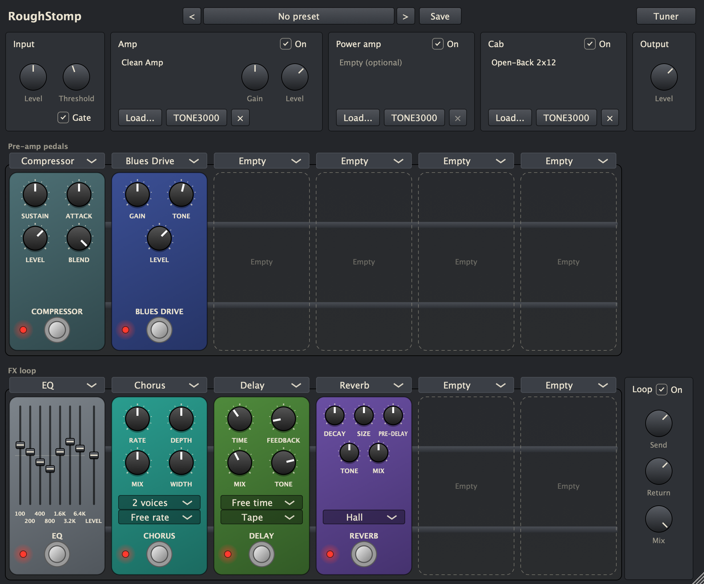
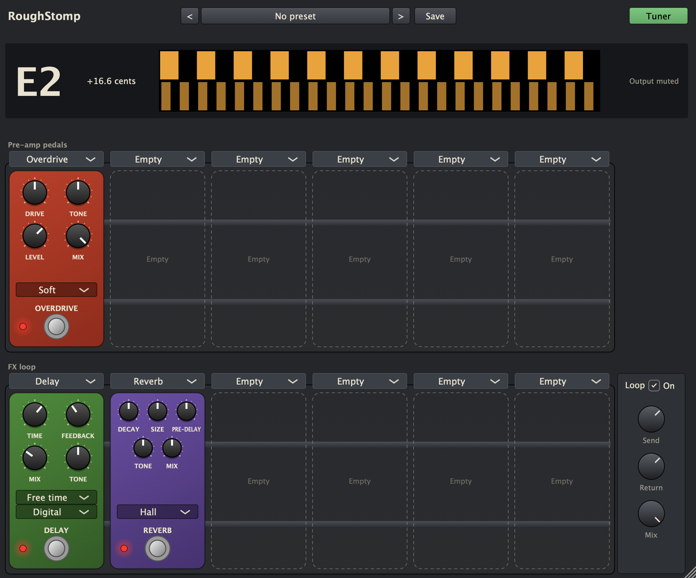

# RoughStomp

A guitar rig for macOS: pre-amp pedals, a [NAM](https://github.com/sdatkinson/NeuralAmpModelerCore) amp capture, an effects loop, an optional power amp and a cabinet IR. Use it as a standalone app with your audio interface, or as a VST3/AU plugin, for example as an insert in [RoughTrack](https://github.com/dantaipan/roughtrack), its companion DAW.

**[Download RoughStomp for macOS](https://github.com/dantaipan/roughstomp/releases/latest)**: macOS 13 or later, Apple Silicon or Intel, signed and notarized. The disk image has the app and the plugins.



See [PLAN.md](PLAN.md) for the roadmap.

Plugins (VST3, AU and a standalone app each):
- **RoughStomp**: the full rig. Pre-amp pedals -> NAM amp capture -> FX loop -> optional power amp capture -> cabinet IR. Load it in RoughTrack or any DAW like AmpliTube (with RoughTrack's own amp off), or run the standalone app with your audio interface.
- **RoughStomp Overdrive**: the overdrive on its own.

## Using the rig

- **Pedals:** pick a pedal from the menu above a slot. Footswitch = on/off. Six slots before the amp, six in the FX loop. Any pedal goes in any slot:
  - *Overdrive*, *Boost*: for in front of the amp
  - *Fuzz* (lower *Bias* for a gated, sputtering sound), *Big Fuzz* (long sustain, scooped tone), *Clean Drive* (keeps the guitar's own sound; *Gain* brings in more grit), *Blues Drive* (touch-sensitive and amp-like, with full lows; cleans up as you play softer)
  - *EQ*: 7-band graphic EQ (100 Hz to 6.4 kHz, ±15 dB) and level, on sliders
  - *Chorus*: 1–3 voices, stereo width
  - *Tremolo*: sine, triangle or square; *Spread* pans it across the sides (100% = auto-pan)
  - *Vibrato*, *Flanger*, *Phaser*
  - *Delay*: digital, tape or ping-pong. Tape behaves like a tape echo: short times are bright and steady, long ones darker and wobblier, so *Tape* at about 80–140 ms with low *Feedback* is a slap-back (or load the *Slapback* preset)
  - *Reverb*: room, hall or plate; *Spring*: three springs with dwell
  - *Compressor*: sustain, attack, level, blend (parallel compression)
  - *Wah*: *Position* is the pedal (map an expression pedal or automation to it in your host), or *Auto* for an envelope filter

  Drag a pedal by its body onto another slot to swap them, in either row; settings travel with it.

  Delay and the modulation pedals have a *Sync* menu that follows the host tempo (120 BPM standalone); while synced, their Time or Rate knob is ignored, and while the host plays, synced modulation lines up with the beat. Delay and the reverbs let their tails ring out when switched off.
- **Presets:** the bar at the top. Arrows step through presets, the name opens the menu, *Save* saves (over your own preset, or as a new one). Factory presets set pedals and settings but keep your amp and cab; your own presets save everything, including the files. A `*` means you've changed something since loading. They're `.rsrig` files in `~/Library/Application Support/RoughStomp/Presets` (*Show Presets Folder* in the menu).
- **Tuner:** the *Tuner* button: a strobe, as in RoughTrack (bands drift right when sharp, left when flat, stand still in tune). Mutes the output while it's on.

  
- **Gate:** next to *Input*. Switch it on and turn *Threshold* up until the hiss between notes goes.
- **Window:** drag the corner to resize (70–150%); sessions remember the size.
- **Look:** everything around the pedals matches RoughTrack (same colours, buttons, menus, knobs and strobe tuner, from `ui/include/rs_ui/Family.h`); only the pedals look like hardware, on purpose.
- **Amp:** *Load...* a `.nam` capture, or choose one from *TONE3000* (below). *Gain* drives the capture, *Level* sets what comes out (captures are levelled to the same loudness automatically).
- **Power amp:** optional. Leave it empty for normal captures, which already include the power amp. For a true pre/power split, load a preamp-only capture as the amp and a power-amp capture here. It runs once per stereo side, so it costs twice the CPU of the amp.
- **Cab:** *Load...* an IR (WAV/AIFF), or choose one from *TONE3000*. Switch it off for "full rig" captures that already include a cab.
- **Sample rate:** any rate works. A capture runs at the rate it was made at (usually 48 kHz); at any other rate it is resampled, which adds about 1.5 ms of latency (reported to the host, so it's compensated). Cabinet IRs are resampled to the session rate too.
- Sessions remember everything, including the file paths. A missing file is flagged in amber and its path is kept.

## TONE3000

**Powered by [TONE3000](https://www.tone3000.com).** The *TONE3000* button in the Amp, Power amp and Cab boxes opens TONE3000's library of NAM captures and IRs of real gear, made by a community of musicians:

- **Sign in** once: RoughStomp shows a code to confirm at tone3000.com. Every RoughStomp shares the sign-in (the app, and the plugin in any host). *Sign out* is at the top of the browser.
- **Your lists**: *Favorites*, *Created* and *Downloaded*, plus what's *Trending* and the *Latest*, showing what the slot can load (captures for the amps, IRs for the cab).
- **Browse TONE3000** opens TONE3000's own picker in your web browser, for searching the whole catalog; the tone you choose comes back to RoughStomp.
- **A tone** shows its models (pick one), its description and its licence; *Load* downloads the model and loads it like a file of your own. Respect each tone's licence: it's the creator's.
- **Loaded**, a slot shows the tone with the T3K mark; click its name to switch to another model of the same tone.
- Downloads are kept in `~/Library/Application Support/RoughStomp/TONE3000/Downloads`, so sessions and presets reopen offline. On another Mac, or if a file has gone, it's downloaded again once you're signed in.

## First-time setup (macOS)

```bash
# 1. Tools
brew install cmake ninja
# Install pluginval from https://github.com/Tracktion/pluginval/releases
#   (copy pluginval.app to /Applications)

# 2. Repo and JUCE (use the same JUCE tag as RoughTrack)
cd roughstomp
git init
git submodule add https://github.com/juce-framework/JUCE.git external/JUCE
cd external/JUCE && git checkout 9.0.4 && cd ../..
chmod +x tools/validate.sh

# 3. Open in VS Code and accept the recommended extensions
code .
```

VS Code (CMake Tools) configures automatically using the **Debug** preset. Catch2 is downloaded on the first configure.

## Everyday use

| What | How |
|---|---|
| Build | ⇧⌘B (Build (Debug) task) |
| Run unit tests | Command Palette → *Tasks: Run Test Task* |
| Validate plugin | *Tasks: Run Task* → *Validate plugin (pluginval)* |
| Debug in AudioPluginHost | Run and Debug → *Debug in AudioPluginHost* (F5) |
| Debug inside RoughTrack | Run and Debug → *Debug in RoughTrack* (prompts for the path) |

Command line equivalent:

```bash
cmake --preset debug
cmake --build --preset debug
ctest --preset debug
tools/validate.sh debug
```

### Regression renders

`fx-core-tests "[regression]"` runs every pedal, at its defaults and pushed
hard, over a fixed synthetic guitar part and compares a fingerprint of the
result (energy in five bands per 2048 samples, per channel) with the
reference in `fx-core/tests/regression/` to within 0.1 dB. Any audible change
to a pedal fails it and says where. After an intended change (or a new pedal),
rewrite the references and review the diff:

```bash
RS_UPDATE_REGRESSION=1 build/release/fx-core/fx-core-tests "[regression]"
git diff fx-core/tests/regression
```

## Offline rendering (rs-render)

Runs an fx-core effect over a WAV file, the same way a DAW would (block by
block), and writes a latency-compensated 32-bit float WAV that lines up
sample-for-sample with the input. Use it for A/B listening and null tests.

```bash
R=build/debug/tools/render/rs-render_artefacts/Debug/rs-render
$R --list                                        # every pedal and its controls
$R delay di.wav out.wav time=380 feedback=30     # a pedal, controls by id in their own units
$R tremolo di.wav out.wav sync=3 --bpm=96        # synced pedals follow --bpm (default 120)
$R gain di.wav out.wav --block=64 --24bit        # host block size, 24-bit output
```

Every pedal in `fx::registry` works here automatically.

## Rendering through a built plugin (rs-host-render)

Loads a built plugin like a DAW would, sets it up through its saved state
(the same path a session restore takes) and renders a WAV through it.

```bash
H=build/release/tools/host-render/rs-host-render_artefacts/Release/rs-host-render
P=build/release/plugins/Rig/Rig_artefacts/Release/VST3/RoughStomp.vst3
$H $P di.wav out.wav "Rig.ampFile=/path/amp.nam" "Rig.cabFile=/path/cab.wav"
$H $P di.wav out.wav Rig.loop1=overdrive loopMix=50 pre1_on=0 input=3
```

`id=value` sets a parameter in its own units; `Rig.key=value` sets a rig
attribute (`ampFile`, `powerFile`, `cabFile`, `pre1`..`pre6`, `loop1`..`loop6`
with pedal ids like `overdrive`, `boost`, `eq`, `chorus`, `delay`, `reverb`,
`tremolo`, `vibrato`, `flanger`, `phaser`, `spring`, `compressor`, `wah`,
`fuzz`, `bigfuzz`, `cleandrive`, `bluesdrive`).
Slot knobs are `pre1_k1`.. and run 0..1 across the pedal's range (log for
frequencies and times). A pedal set this way keeps the knobs' values rather
than its own defaults, so set every knob you care about. Prints latency, peak and RMS.

`rs-rig-snapshot` saves a picture of the rig's editor, set up with the same
kind of settings, for checking the GUI without a DAW:

```bash
build/release/tools/rig-snapshot/rs-rig-snapshot_artefacts/Release/rs-rig-snapshot editor.png Rig.loop1=delay --scale=2
```

It can also load or save presets (`--preset=Lead`, `--save-preset=Name`),
swap slots (`--swap=pre1,loop3`), set state attributes (`State.uiScale=0.8`)
and check the tuner (`--tone=82.4` plays that pitch through the rig and prints
what the tuner reads).

The build copies the plugin to `~/Library/Audio/Plug-Ins/VST3` and `.../Components` automatically, so DAWs see it after a rescan.

If an AU's name or manufacturer changes but hosts keep showing the old one, macOS's AU registry is stale (`auval -a | grep Rstm` shows what it has). Clear it and rescan:

```bash
rm ~/Library/Caches/AudioUnitCache/com.apple.audiounits*.cache
killall -9 AudioComponentRegistrar
```

## First run in AudioPluginHost

1. F5 with *Debug in AudioPluginHost*
2. Options → Edit the list of available plug-ins → scan VST3 / AU
3. Right-click the graph → add *RoughStomp Overdrive*; wire Audio Input → plugin → Audio Output
4. File → Save the graph as `tools/test.filtergraph` so it reopens next time

Breakpoints in `plugins/` and `fx-core/` hit inside the host.

## Layout

- `fx-core/` — DSP only, plain C++20 with no JUCE dependency; linked by plugins and RoughTrack
  - `Smoother.h`, `Filters.h`, `Waveshapers.h`, `Oversampler.h` — shared building blocks
  - `effects/` — complete effects implementing `fx::Effect`
  - `Pedal.h` — `fx::Pedal` (an effect that describes its own controls) and `fx::registry`
  - `Chain.h`, `Handoff.h` — pedal chains and lock-free message-to-audio handoff
- `ui/` — shared pedal GUI (`rs::ui`): look-and-feel, knobs, footswitch, LED, mini toggle, enclosure
- `plugins/Overdrive/` — JUCE wrapper (parameters, presets, state, editor)
- `plugins/Rig/` — the RoughStomp rig: pedal slots, NAM amp (`AmpModel`, ported from RoughTrack), loop, cab
- `cmake/NAM.cmake` — fetches NeuralAmpModelerCore (MIT), the same version RoughTrack uses
- `tools/validate.sh` — pluginval runner
- `tools/render/` — rs-render: fx-core effects over a WAV
- `tools/host-render/` — rs-host-render: a built plugin over a WAV
- `tone3000/` — TONE3000 (`rs::t3k`): sign-in, lists, models, downloads and the Select flow, JUCE-only, with its own tests (`t3k-tests`)
- `tools/t3k/` — rs-t3k: TONE3000 from the command line, through the same library

## Using fx-core in RoughTrack

Add this repo as a submodule of RoughTrack (or point at it), then:

```cmake
add_subdirectory(path/to/roughstomp/fx-core fx-core)
target_link_libraries(RoughTrack PRIVATE fx::core)
```

fx-core's tests are only built when `ROUGHSTOMP_BUILD_TESTS` is ON, which it isn't inside RoughTrack, so nothing else is needed.

## Releasing

`tools/make_release.sh` builds the standalone app and the VST3 and AU plugins
as universal binaries (Apple Silicon and Intel), signs them with your
Developer ID, has Apple notarize them, and wraps them in a signed, notarized
disk image: `dist/RoughStomp-<version>.dmg`. It needs a Developer ID
Application certificate and notarytool credentials saved once (the same ones
RoughTrack uses work):

```bash
xcrun notarytool store-credentials roughtrack-notary --apple-id <email> --team-id <team>
tools/make_release.sh
```

TONE3000 needs RoughStomp's publishable key (client ID) in
`tone3000/client_id.local`, which git ignores; every build reads it, and the
release script stops if it's missing. (A build without it simply doesn't
offer TONE3000.)

The disk image holds `RoughStomp.app` (drag it to Applications) and a
`Plugins` folder with the two plugins, links to the plugin folders and a note
on installing them. The version comes from `project()` in `CMakeLists.txt`.

Every build is signed with the hardened runtime (an Apple Development
certificate if there is one, otherwise ad hoc), so a release has no
surprises. The standalone app asks for microphone access the first time, and
starts with the input on unless it's a microphone (feedback).

## Licence

AGPL-3.0, like RoughTrack (see LICENSE).
